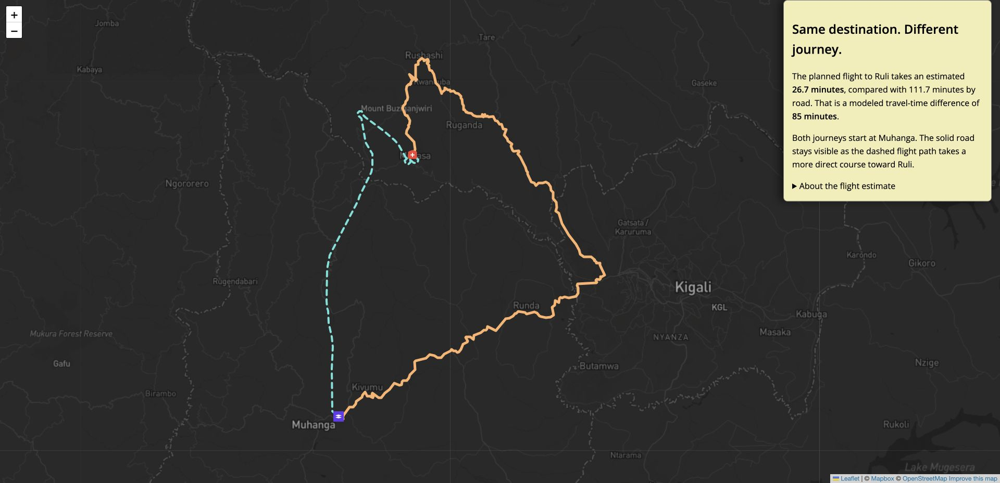
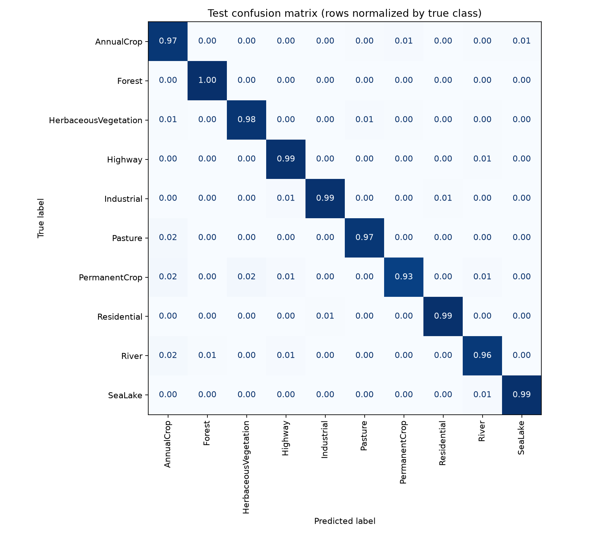
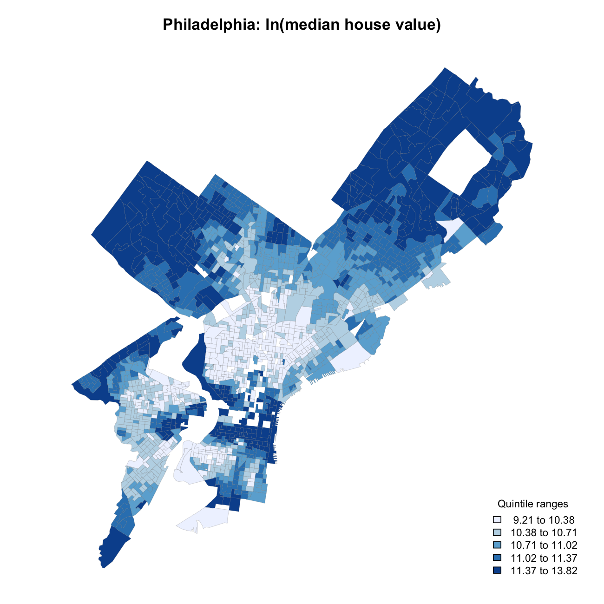
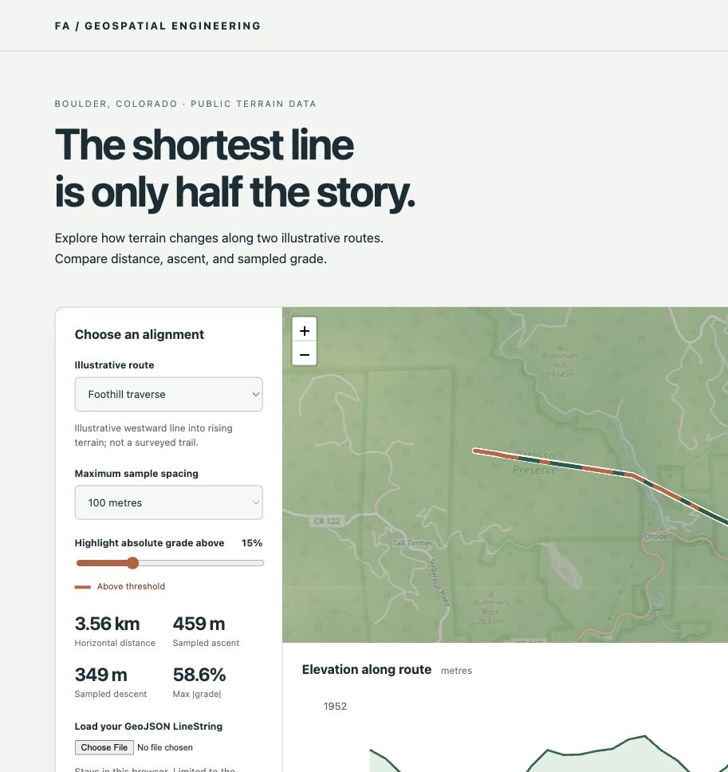
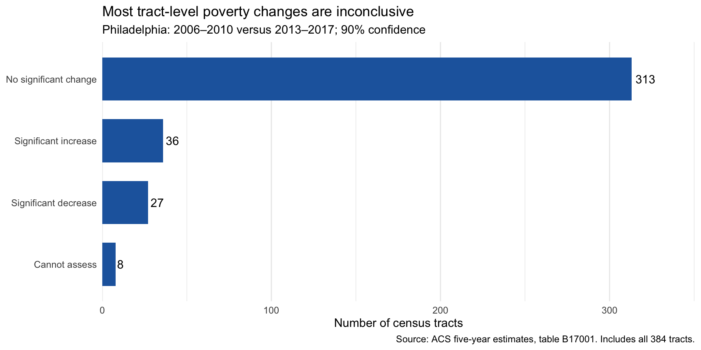

These case studies separate **professional work**, **personal engineering demonstrations**, and **coursework**. Public repositories and demos show what is implemented. Proprietary work is described at a high level; employer code, internal screenshots, and operational data remain private.

## When blood takes a shortcut {#blood-shortcut}

[ACADEMIC PROJECT · JAVASCRIPT / LEAFLET]{.eyebrow}

**Question.** How does geography shape medical-delivery journeys in Rwanda?

**Work.** I adapted a scrolling-map structure into an authored story, pairing geographic context and route reveals with modeled road-versus-drone travel comparisons. JavaScript modules load scene-specific GeoJSON into a persistent Leaflet map. A companion HTML table provides another way to read the travel estimates.

**Interpretation.** The map illustrates outbound transport scenarios; these are not observed complete deliveries or site-specific mortality estimates. The healthcare-name screen does not establish blood-service eligibility. This independent course project relates to my prior work at Zipline. Sources and assumptions appear in the narrative.

{.project-image fig-alt="Live story-map scene showing the orange road route and dashed turquoise flight path between Muhanga and Ruli in Rwanda."}

[Explore the story map](https://freddie999.github.io/story-map-project/) · [Repository and methods](https://github.com/Freddie999/story-map-project)

## Land-cover classification with convolutional networks {#land-cover}

[ACADEMIC PROJECT · PYTHON / PYTORCH / REMOTE SENSING]{.eyebrow}

**Question.** Which architecture and training changes improve classification of EuroSAT RGB image patches?

**Work.** I compared five CNN configurations, starting with a corrected starter baseline and testing deeper features, global average pooling, image augmentation, skip connections, and dropout. The split, seed, optimizer, and training budget were held fixed. Model selection used validation results; training normalization and augmentation excluded validation and test images. The work adapts a course notebook by Xiaojiang Li.

**Results.** The selected augmented plain CNN correctly classified 3,958 of 4,050 held-out test images: **97.73% accuracy** and **0.9767 macro F1**. Skip connections and dropout did not improve the validation selection metric in this run. Per-class errors, learning curves, and an image-split manifest accompany the notebook.

{.project-image fig-alt="Confusion matrix showing held-out predictions for ten EuroSAT land-cover classes."}

**Limits.** These results use one seed and a random image split. Similar or nearby scenes can occur across partitions; the scores do not establish generalization to a new region. The starter-to-deeper comparison changes several architecture components together.

[Executed notebook](https://github.com/Freddie999/ai-urban-sustainability/blob/main/Homework4.ipynb) · [Saved metrics and figures](https://github.com/Freddie999/ai-urban-sustainability/tree/main/homework4-output)

## Explaining Philadelphia housing values {#housing-values}

[TEAM ACADEMIC PROJECT · STATISTICS / R]{.eyebrow}

**Question.** How are neighborhood characteristics associated with median housing values across Philadelphia block groups?

**Team.** Vincent Bio Bediako, Frederick Abalo, and Emmanuel Sampson. This is a shared report; the available submission does not document individual task allocation.

**Methods.** We analyzed 1,720 block groups from the supplied 2000 Census dataset, mapped neighborhood characteristics, fitted a log-outcome multiple regression, examined residuals, and compared models using the same five cross-validation folds.

**Results.** The four-predictor model explains approximately **66% of variation in logged house values**. Its held-out RMSE was **0.366440 log units**, compared with **0.442722** for vacancy and income: a **17.2% reduction** in this comparison. These are the existing report's results.

{.project-image fig-alt="Map of logged median house values across Philadelphia block groups using 2000 Census data."}

**Limits.** Historical block-group associations do not establish individual-house predictions or causal effects. Residual plots suggest nonlinearity, unequal variance, and geographic clustering. Random cross-validation can be optimistic when nearby observations appear in both training and validation.

[Read the team report](reports/philadelphia-housing-values.html) · [Quarto source](https://github.com/Freddie999/MUSA-5080-portfolio/blob/main/reports/philadelphia-housing-values-source.qmd)

## Spatial-data validation API {#spatial-validation-api}

[PERSONAL · ENGINEERING DEMONSTRATION]{.eyebrow}

**Problem.** Spatial APIs need to reject malformed or ambiguous geometry before it reaches downstream systems.

**My contribution.** I developed this independent portfolio demonstration: the validation boundary, transactional ingestion, spatial-query API, small demo interface, Docker setup, and tests. It uses synthetic survey features, not employer datasets.

**Implementation.** Python, FastAPI, Shapely, PostgreSQL/PostGIS, psycopg, Docker, and GitHub Actions. The service accepts a bounded 2D WGS84 GeoJSON subset, rejects unsupported CRS declarations, validates geometry structure and topology, and inserts an entire batch in one transaction. GiST indexing supports intersection queries; ID-based cursor pagination avoids offset scans.

**Result.** A runnable local service with interactive API documentation. The published suite contains 26 passing tests, including real PostGIS checks for polygon-hole intersections, batch atomicity, pagination, and invalid input. The repository documents reproducible setup and CI.

**Limits.** This is a local demonstration without authentication, tenant isolation, or a public API deployment. It does not reproject input or repair geometry. Plausible coordinate bounds alone cannot establish the true CRS. Antimeridian-spanning and 3D geometries are outside its contract.

{.project-image fig-alt="Spatial validation API demo showing a GeoJSON input and HTTP 200 FeatureCollection response for a synthetic survey point."}

[Code, architecture, tests, and setup](https://github.com/Freddie999/spatial-validation-api) · [CI history](https://github.com/Freddie999/spatial-validation-api/actions)

## Terrain-aware route explorer {#terrain-explorer}

[PERSONAL · ENGINEERING DEMONSTRATION]{.eyebrow}

**Problem.** Route length alone hides differences in elevation, ascent, and steepness.

**My contribution.** I developed this independent demonstration, including the public-data retrieval and provenance script, sampling calculations, linked map/profile interface, local GeoJSON upload, CSV export, and tests. The two alignments are illustrative and independently created.

**Implementation.** JavaScript, Leaflet, Vite, and public Mapzen Terrain Tiles. One bundled elevation tile keeps the example reproducible without an elevation API key. Pixel-center bilinear interpolation estimates elevation; haversine distance and sample-to-sample height changes produce distance, ascent, descent, and grade. Analysis code is separated from browser I/O.

**Result.** The [working demo](https://freddie999.github.io/terrain-route-explorer/) lets visitors compare routes, change sampling distance, inspect the profile, and export samples. Six automated tests cover the mathematical helpers, invalid inputs, bundled-data coverage, and reversal of ascent/descent. CI builds and deploys the static application.

**Limits.** The routes are not verified roads or trails. Terrain pixels are roughly 59 m wide here; denser sampling cannot add source detail. The demo does not optimize routes or model obstacles, access rights, weather, airspace, or flight clearance. It is not a navigation tool.

{.project-image fig-alt="Terrain explorer near Boulder with an illustrative route over public terrain, distance and ascent metrics, and an elevation profile."}

[Live demo](https://freddie999.github.io/terrain-route-explorer/) · [Code and methods](https://github.com/Freddie999/terrain-route-explorer) · [Data provenance](https://github.com/Freddie999/terrain-route-explorer/blob/main/public/data/provenance.json)

Elevation: Mapzen Terrain Tiles; USGS 3DEP, GMTED2010/SRTM; NOAA ETOPO1. Basemap: © OpenStreetMap contributors. Full attribution and source terms are included in the linked repository and demo.

## Geomersive: spatial-data application and tile utilities {#geomersive}

[PROFESSIONAL · APPLICATION IN DEVELOPMENT / PUBLIC LIBRARY]{.eyebrow}

**Problem.** Spatial datasets need a consistent way to organize metadata, uploads, derived products, and map access.

**My contribution.** I own Geomersive and work on its dataset/product catalog, PostGIS-backed metadata, upload workflows, mapping viewers, and processing workers. I maintain the smaller public JavaScript tile-utility library. The application source is private; the public library is the inspectable code example linked here.

**Implementation.** The application uses TypeScript, PostGIS-backed metadata, object storage, and spatial-processing workers. The public library implements Web Mercator XYZ tile counts and longitude/latitude-to-tile conversion. It keeps the tile-math interface small rather than presenting itself as a complete tile service.

**Result.** The public repository includes runnable tests and an example input. A [separate pull request](https://github.com/GeomersiveTeam/geomersive-tile-utils/pull/12) adds input validation, polar/dateline boundary handling, documentation, and additional tests; those changes pass CI but are **awaiting required review**. The [Geomersive website](https://geomersive.org) introduces the business.

**Limits.** The main application remains under development. The public website is not evidence that every planned platform capability is deployed. The tile library does not fetch imagery, serve tiles, or process terrain. No customer deployments, performance figures, or production scale are claimed here.

[Public tile-utility code](https://github.com/GeomersiveTeam/geomersive-tile-utils) · [Pending improvements](https://github.com/GeomersiveTeam/geomersive-tile-utils/pull/12) · [Geomersive](https://geomersive.org)

## Poverty change in Philadelphia {#poverty-change}

[COURSEWORK · MUSA 5080 / ASSIGNMENT 3]{.eyebrow}

**Problem.** A reported change in an ACS poverty estimate may not be distinguishable from sampling uncertainty.

**My contribution.** For this assignment, I reconstructed a tract-level comparison of the 2006–2010 and 2013–2017 ACS five-year estimates, checked tract-period records, calculated poverty rates and uncertainty, and wrote the interpretation. The full report retains the code and course-method assumptions.

**Implementation.** R, tidyverse, tidycensus, gt, and Quarto. The analysis joins periods by GEOID, carries margins of error through the comparison, treats zero denominators as missing, and keeps unassessable tracts separate from those without a detectable change.

**Result.** The existing report identifies 36 tracts with significant increases and 27 with significant decreases at the 90% confidence level, out of 376 assessable tracts. Another 313 have no statistically detectable change; eight cannot be assessed. These are the published assignment's results, not a new analysis for this portfolio update.

**Limits.** Individual tract tests are not adjusted for multiple comparisons. Tracts are not neighborhoods, and the report cannot reproduce the article's neighborhood or race-specific claims. A nonsignificant estimate does not establish no change. The comparison assumes independent sampling errors between the nonoverlapping periods.

{.project-image fig-alt="Assignment 3 chart summarizing poverty-change classifications across all 384 Philadelphia census tracts."}

[Full analysis and code](assignments/assignment3.qmd) · [Quarto source](https://github.com/Freddie999/MUSA-5080-portfolio/blob/main/assignments/assignment3.qmd)

## Uncertainty in California county estimates {#acs-uncertainty}

[COURSEWORK · MUSA 5080 / ASSIGNMENT 2]{.eyebrow}

**Problem.** The same absolute margin of error has different implications for estimates of different sizes.

**My contribution.** I examined 2023 ACS five-year median-age estimates across California's 58 counties, calculated relative margins of error, compared reliability categories with county population, and discussed implications for policy interpretation.

**Implementation.** R, tidyverse, tidycensus, and Quarto. Relative MOE makes uncertainty comparable across estimates. The report documents the original categorization and an adjusted threshold scheme used to examine differences in this dataset.

**Result.** The report identifies Alpine County as having the highest relative MOE, approximately 11.68%, and shows greater relative uncertainty among smaller counties. Code and reflections remain in the original assignment.

**Limits.** Reliability labels depend on chosen thresholds, not an official Census classification. The comparison is descriptive, not a causal model or a funding-allocation rule. Findings concern the selected variable and ACS period.

[Full analysis and code](assignments/assignment2.qmd) · [Quarto source](https://github.com/Freddie999/MUSA-5080-portfolio/blob/main/assignments/assignment2.qmd)

---

For the broader course record, see [Assignments](assignments/index.qmd) and [Weekly Notes](weekly-notes/index.qmd). My [About page](about.qmd) summarizes professional experience that cannot be shown as public source code.
